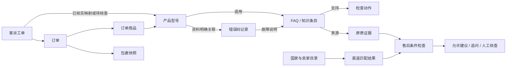
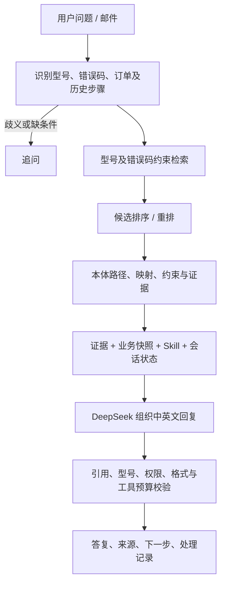
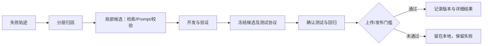

# OntoCare：可追溯的本体客服与受控改进工作台

## 当前工作台与最新工单评测（2026-11-03）

本地工作台包含本体拓扑、类型契约、智能客服、Reports、MCP 工具和评测页面。启动后分别访问 `/ontology/manager`、`/service`、`/reports` 和 `/ticket-evaluation`。详细流程、算法和面试表见 [本体 RAG 流程与技术表](docs/本体RAG流程与面试技术表.md)，评测口径见 [工单评测与面试问答](docs/工单评测与面试问答.md)。

本次冻结当前版本，逐条回放并由 LLM Judge 评分 63 封已见客诉首封邮件：首轮回复与流程通过 51/63（80.95%），平均 9.21/10；另外三组构造五轮对话全程通过 0/3。五条重复裁判的通过判断一致率为 100%，逐维分数一致率为 84%；三条构造的虚假退款完成负例均被识别。人工盲评尚未完成，主模型与裁判使用同系列模型。原始邮件与逐案结果留在本地，不包含在代码交付包中。

上述数字不是独立盲测或真实结案解决率。本轮 63 封没有人工 gold 知识集合，不能报告该集合 Recall@1。此前 300 题已见回归严格集合 Recall@1 为 85.70%；独立测试 Recall@1 大于 90% 且忠实度不下降的上传条件尚未证实。下文历史实验均有各自数据范围和版本，不能与当前工单结果混作同一次测试。

当前在线链路：规则与结构化模型意图识别 → PN/SKU 别名与错误码定位 → E5 标题/正文和 BM25 加权召回 → 可选证据重排 → 同型号知识节点最多两跳 BFS → 证据、图关系、Skill 与业务快照组装上下文 → DeepSeek → 引用与业务校验、SOP 状态机。建图采用工程定义的 Schema、字段映射和正则；未实现 Leiden 社区检测、GNN 或自主训练模型参数。当前多轮流程存在重复确认问题，渠道匹配两条路径的规则口径也需统一。


## 本轮资料补全与来源动作修复（本地试验）

当前客服已接入按型号限定的官方正文快照；22篇正文形成86条Q&A关联，4个视频页仍未解析，2条适用范围不明确的关联不启用。网页与MCP知识查询使用同一正文混合检索及引用快照。原Excel与旧gold不覆盖。

同一72场景的机器流程通过率保持 **71/72（98.61%）**，模型完成72/72；固定12请求的Ragas忠实度 **91.50%→92.77%**。配对有1项改善、1项退步，均值区间包含零，不能宣称整体无回归或真实解决率提高。18份旧回复各复评3次，判定一致率88.89%，2份仍待人工裁定。

当前300题已见回归仍为 **Hit@1 87.00%、集合Recall@1 85.70%**。细分段和正文重排候选的失败结果、模型支持性检查造成的完成率回归都保留，没有为了过线采纳。新独立确认未运行，私有上传门槛新增独立忠实度不下降检查，本轮未上传。

入口：[客服](http://127.0.0.1:5112/service)、[本轮修复记录](http://127.0.0.1:5112/quality#source-repairs)。完整方法、数据边界、候选结果和重现步骤见[资料补全与裁判一致性修复](docs/资料补全与裁判一致性修复.md)。

客服用户端已增加工作台入口、16 笔源表演示订单选择、连续追问建议、真实查询进度和校验后分段答复；右侧图谱可点击、拖动并查看来源。客户表达使用独立 Prompt／Skill，沿用现有检索与业务校验，不将少量界面实测当作质量达标证明。详见[智能客服用户端体验](docs/智能客服用户端体验.md)。

> 私有研究项目。原始邮件、订单资料、API Key、运行数据库与模型缓存保留在本机。本轮本地候选在同一批 300 个历史回归问题上，最佳首条命中率为 87.67%，资料集合 Recall@1 为 86.37%，尚未通过“大于 90% 才上传”的门槛。本文和本轮新增实验未上传；原有 87% 历史实验分支继续保留。

OntoCare 面向 eufy 多型号、跨语言、售后条件复杂的客服任务。它把产品、错误码、FAQ、订单商品、包裹、购买渠道及服务条件组织成有来源的业务对象，再让一个受约束的客服 Agent 查询这些对象、调用处理 Skill，生成中英文答复或邮件草稿。

本项目借鉴 EvoOntology 的语义记录、查询与版本机制，以及 Palantir AIP Evals 的测试套件、预期结果、评测器和版本比较方法。在本地 Python/Flask 应用中实现，不依赖 Palantir 商业平台。

## 本轮工作台实测与交付

新版入口：[智能客服](http://127.0.0.1:5112/service)、[本体工作台](http://127.0.0.1:5112/ontology/manager#topology)、[评测证据台](http://127.0.0.1:5112/quality)。完整方法、逐项指标和消融见 [工作台评测与客服改进交付](docs/工作台评测与客服改进交付.md)。

- 同一300题已见检索回归，实际旧标题配置到当前正文＋证据核验：Hit@1 **68.00%→87.00%**；资料集合Recall@1 **66.87%→85.70%**。PN已给定，缓存可复用，不是独立确认。
- 同一72个场景各重复3次，共432次场景执行、444次HTTP回复：机器判定流程通过 **205/216→212/216（94.91%→98.15%）**；模型完成回复 **215/222→222/222**。主要增益来自边界校验；抽检已发现裁判一致性与来源正文缺口，尚未经过独立人工校准，不是真实客户解决率。
- 每版本12答复的Ragas子集：Faithfulness **89.42%→87.19%**，没有改善；原分与争议保留。五维Judge通过不能代替事实忠实度和人工确认。
- 18题局部消融：完整18/18；去Skill文字与状态16/18；去本体工作流18/18。本体在该小样本的通过率增益没有得到证明；Skill差异主要体现在两例多轮路由决策。
- 当前运行版本可查询 `/api/runtime`；回复记录同一指纹，评测页核对是否匹配。增加图路径、约束与自愿反馈展示；来源适用性疑点在证据侧标注。

**当前默认版本尚未满足严格90%召回验收，本轮不上传GitHub。**原私有实验分支仍保留，原公开仓库与Render不改动。人工抽检20组保留空白审核字段；本机自愿反馈不算生产CSAT。

## 解决什么问题

| 客服问题 | 本项目的处理方式 |
|---|---|
| 不同型号看起来相似，容易串用排障资料 | 先识别型号/PN，保留来源适用范围；型号不明或歧义时追问 |
| 中文问题查不到英文 FAQ | 中文查询改写为英文检索表达；保留型号、数字、否定与已完成操作 |
| 回答流畅但没有证据 | 返回实际引用及原表行号，记录检索结果、本体路径、规则与工具轨迹 |
| 客户已经做过排障，客服仍重复建议 | 维护会话中的型号、故障和已完成操作，Skill 约束后续步骤 |
| 部分发货、多包裹被误说成全部发货 | 订单、订单商品、包裹分层保存；未核实包裹内容不作归属承诺 |
| 经销商命中被误当成质保通过 | 渠道匹配和售后资格分别判断，区分客户陈述与资料核验 |
| 修改 Prompt 后只看几条“好例子” | 冻结来源分组用例，保存逐题结果、拒绝的候选、回归和时延 |

它是比赛资料驱动的本机演示和研究工作台。订单与物流是原始资料快照；邮件只生成草稿；退款、换货、补发、发信和转人工没有接入真实执行系统。

## 界面入口与演示顺序

服务启动后访问：

| 页面 | 地址 | 可以做什么 |
|---|---|---|
| 智能客服落地页 | `http://127.0.0.1:5112/service` | 提问、补充订单/国家/卖家、查看双语回复和证据 |
| 本体工作台 | `http://127.0.0.1:5112/ontology/manager#topology` | 拖动拓扑、查看节点/边，浏览类、属性、关系、实例和来源 |
| 全量资料库 | `http://127.0.0.1:5112/library?kind=qa` | 分页搜索 Q&A 原文；也可切换工单与媒体 |
| 评测证据台 | `http://127.0.0.1:5112/quality` | 查看数据划分、候选曲线、逐案打分、失败原因和人工抽检表 |
| Reports | `http://127.0.0.1:5112/reports` | 选择管理者/GTM 等报告模板，依据本体与资料快照生成报告 |
| 本地 ActionType | `http://127.0.0.1:5112/ontology/actions` | 查看受控本地变更与审核记录；不执行真实售后 |

建议先在客服页面点击示例“E25 故障排查”，发送：

> 我的 E25 报错误码3212，应该先检查什么？

再继续问：

> 我已经清理并检查过滚筒了，还是不行，下一步怎么办？

还可以验证边界：

- `S1 Pro 不能用了，应该怎么办？`：应区分扫地机与吸乳器。
- `T9999 保修多久？`：应要求核对型号，不编造保修期限。
- `T8D04 的可清洗配件保修多久？`：应区分配件与主机及适用条件。
- 在“补充订单与购买渠道”填入比赛资料里的订单号，查询各件商品、包裹和原始金额字段。
- 提供购买国家与卖家，再检查渠道目录；目录匹配不能直接批准质保或退款。

## 从原始 Excel 到知识与本体

### 数据底座

规范输入为 `黑客松智能服务赛题资料.xlsx`，并检查三个拆分文件与总表的对应字段。镜像记录不重复累加。

- 63 封首封客诉邮件，保留来源和原始业务字段。
- 875 条 Q&A，其中 872 条可供客服召回，3 条隐藏内容仅能在资料库核查。
- 16 个唯一订单、24 条订单商品；多包裹独立表示。
- 330 条去重经销商记录。匹配依据购买国家和卖家，不把收货地当购买地。
- 嵌入图片登记原始文件、哈希与锚点；未据此宣称已经理解图片或核实附件归属。

读取时修复工作表错误范围，仅根据真实合并单元格恢复共享字段，不盲目向下填空。每条重要知识保存文件哈希、工作表、行号、适用型号和转换记录。产品线根据实际字段核实，不能仅靠“Breast Pump”文件名分类。

**金额边界：**来源行的金额不是已确认的订单总额。币种和金额粒度不明确时保持未知，不擅自相加或乘以数量。包裹中实际装了哪些商品，缺少依据时标待核查。

### 双本体与本体地图

Service Ontology 与 Decision Ontology 是同一底座的两种业务视图：

- **Service Ontology**：当前是什么对象，相关知识、故障、检查动作和来源在哪里。
- **Decision Ontology**：条件是否核实、还缺什么、允许建议什么、禁止承诺什么。



图中每条边需要真实映射或来源。没有依据的购买渠道关联、包裹内容关联和型号映射保留待核查，不为了让图“连起来”而补造边。

底层沿用 EvoOntology 四种语义对象：

| 语义对象 | 含义 |
|---|---|
| Term | 产品、错误码、知识主题、部件、条件、检查动作等概念 |
| Mapping | 概念在原表/本地快照中对应什么记录或字段 |
| Evidence | 原文、来源位置、适用范围与版本 |
| Constraint | 型号范围、动作前提、政策条件、未核实信息边界 |

工作台另外展示 Object Type、Link Type、Action Type、Function Type 契约。拓扑、类层级、关系表、属性表和实例详情是查看同一批业务对象的不同入口。

本体构建以明确字段、资料和可追溯规则为起点；当前没有用社区检测自动生成售后政策，也没有实现通用 OWL/SWRL 逻辑推理器。图搜索是受型号约束的两跳广度优先遍历，最多 30 个概念、6 条证据，不从产品中心节点无限扩散。

## 客服 Agent 如何使用这些数据



- 一个客服 Agent 负责在线会话；本体构建与评测改进是离线流程。
- Skill 分为型号消歧、故障排查、订单物流、售后信息收集。Prompt 每次加载，轨迹保存内容哈希。
- 本体快照和局部图缓存检查版本、来源文件变化及图搜索契约；查询改写缓存绑定输入、模型和 Prompt。固定 FAQ 检索缓存绑定型号、语言和数据/本体版本；修改检索实现后还需清理旧 FAQ 缓存再验收。缓存用于复用计算，不把旧回复当作新事实。
- 主模型可以使用受限工具，单次最多六次调用；代码校验参数和产品范围。
- 返回中英文答复、原文引用、缺失条件和建议。模型不能覆盖代码侧业务边界。
- 连接失败与输出校验失败保留真实状态，离线保底不算模型成功。

二阶段重排器的新增候选、训练范围、验证选择和冻结测试保存在 `reports/reranker-v3/`。评测未满足上传门槛之前，仅保留本地实验状态；不能把验证集成绩写成最终成绩。

## 安装与运行

已验证环境为 Python 3.12，项目要求 Python 3.11+。首次安装依赖、下载 E5 或重排模型需要网络。先进入项目目录：

```sh
python3 -m venv .venv
.venv/bin/python -m pip install -e '.[vectors,dev]'
```

提供包含四份原始 Excel 的目录，并执行：

```sh
.venv/bin/python -m ontocare.cli ingest --source "/path/to/competition-files"
.venv/bin/python -m ontocare.cli build
.venv/bin/python -m ontocare.cli vectors
.venv/bin/python -m ontocare.cli business-build --source "/path/to/competition-files/黑客松智能服务赛题资料.xlsx"
.venv/bin/python -m ontocare.cli serve --port 5112
```

`build` 不覆盖已存在的冻结版本。新机器不带原始邮件、订单数据库、API Key 或模型缓存；重放涉及这些对象的场景前，需要拥有者导入原资料。只查看已交付的构造知识评测和聚合记录，可直接阅读相应 JSON、文档与曲线。

若仅需重建全量资料浏览入口：

```sh
.venv/bin/python -m ontocare.cli catalog --source "/path/to/competition-files"
```

### 模型配置

服务支持本机忽略文件 `local/deepseek-config.json`，格式如下；已有配置可继续沿用：

```json
{
  "base_url": "https://llmapi.paratera.com/v1",
  "text_model": "DeepSeek-V4.1-Flash",
  "api_key": "填写你自己的密钥"
}
```

密钥仅由后端读取。该文件不可加入 Git，不可放入前端。也可以使用 `ONTOCARE_LLM_CONFIG` 指向本机其他配置，或设置 `ONTOCARE_LLM_BASE_URL`、`ONTOCARE_LLM_API_KEY`、`ONTOCARE_LLM_MODEL`。`/api/status` 仅返回配置状态、模型名及主机，不返回密钥。

其他命令需要模型时可显式指定配置文件：

```sh
ONTOCARE_LLM_CONFIG="$PWD/local/deepseek-config.json" .venv/bin/python -m ontocare.cli model-probe
```

未配置模型时，离线流程仍能运行，但不能生成真实模型质量分数。Judge 可使用单独的 `ONTOCARE_JUDGE_CONFIG`；当前记录中的同模型裁判必须标明同源偏差，独立调用不等于独立模型。

## HTTP 与 MCP 接口

客服：`POST /api/chat`、`POST /api/mail/draft`。例如：

```json
{
  "message": "我的 T2353 报错3212，已经检查并清理过滚筒了。",
  "mode": "live",
  "context": {}
}
```

返回的 `session_id` 可在后续请求中复用。补充信息支持 `sku`、`order_number`、`country`、`seller`；它们是用户输入，不自动等于核验事实。邮件返回草稿且 `sent=false`。

其他入口包括 `/api/trace/<trace_id>`、`/api/ontology`、`/api/status`、`/api/quality/summary` 和全量资料分页接口。服务默认只绑定 `127.0.0.1`。

本地 MCP 使用官方 SDK 的 stdio 服务：

```sh
.venv/bin/python -m ontocare.cli service-mcp
```

在 MCP 客户端中使用本项目 Python 解释器的绝对路径，并指定本项目为工作目录。工具覆盖对象/类/关系/实例查询、局部拓扑、知识搜索、订单快照、经销商核查、服务决策及 Reports。代表工具包括 `get_instance_topology`、`search_knowledge`、`lookup_order`、`check_dealer`、`plan_customer_service`、`evaluate_service_decision`。本地审核/报告保存是受限写入，与真实退款或发信不同。

MCP 解决“外部智能体如何调用受控工具”；本体提供业务对象与约束；Skill 和 Prompt 提供处理方法；评测判断流程是否可靠。这四件事需分别实现。

## 评测怎么做，数字怎么理解

采用来源分组与冻结测试：开发集用于候选生成；验证集选择配置；最终集在候选冻结后运行。相同来源和中英文形式留在同一组。最终集一旦查看，后续使用必须标为回归，不能继续称未见盲测。

历史基准为 750 个来源案例、1,500 个中英文问题形式，不是 1,500 个真实客户。新增确认集及它与历史来源的关系以 `reports/reranker-v3/confirmation-protocol.json` 为准；新措辞测试不等于新来源或真实生产工单。

本轮在同一批历史回归题上的完整候选对比、失败尝试和图表见 [本地改进记录](reports/reranker-v3/local-status.md)。相比上一轮，最佳候选的首条命中率从 87.00% 到 87.67%，资料集合 Recall@1 从 85.70% 到 86.37%，均只提高约 0.67 个百分点。这不足以宣称已满足目标或已经收敛。新措辞确认集保持未测，真实问题解决率保持未测。

配对检查发现 12 个问题改善、10 个问题退步，净增 2 个命中；按来源案例分组重采样，命中率变化的 95% 区间为 −3.00 至 +4.33 个百分点，包含零。因此这轮候选也不能宣称已经带来稳定提升，尚未替换默认客服实现。

| 指标 | 定义与边界 |
|---|---|
| 首条命中 Hit@1 | 第一条是否命中至少一个冻结的可接受来源 |
| 资料集合 Recall@1 | 第一条命中的标准资料数量 / 全部标准资料数量，多标准来源时不同于 Hit@1 |
| Recall/Hit@K、MRR | 多条候选的覆盖和相关来源排序位置 |
| 离线任务/流程通过率 | 原始接口回复满足参考、规则、状态和裁判条件，不等于客户结案 |
| Ragas Faithfulness | 实际答复中的声明是否受模型实际收到的证据与权限上下文支持 |
| Context Recall / Precision | 参考事实覆盖和召回上下文精度 |
| Answer Relevancy | 回复对当前问题的相关程度 |
| 平均、P50/P99 | 本机 HTTP 开始至完整 JSON 返回；非首 token 时间，小样本 P99 不作为 SLA |
| 图检索及 token | 区分图遍历、文本检索、查询改写、模型生成及额外评测调用 |
| 业务解决率、CSAT、重复咨询率 | 缺少真实结案、问卷与客户关联结果时保持未测 |

五维 LLM Judge 各 0–2 分：事实与型号、证据支持、步骤与历史、业务条件与边界、双语清晰度。通过需总分至少 8、任务满足、模型完成、程序硬检查通过，并满足预期业务决策；关键维度不能为零。每项保存理由。

人工抽检采用匿名打乱的前后回复，审核人、结论与理由初始为空。机器裁判和助手检查不能冒充业务专家已确认。真实客户解决率还需要用户确认、转人工回执、结案、重开和重复联系记录，当前没有这些结果标签。

### 受控改进，而非自动改政策



当前包含部分模型提案和工程协助的受控优化。学习排序权重、改写 Prompt 和运行校验的改进，不等于已完成主模型 RLHF，也不等于本体 Schema、访问工具和改进器本身能自主进化。

本轮 GitHub 上传条件是：历史预留回归与新确认测试的首条命中率、资料集合 Recall@1 均严格大于 90%，用例数量完整，运行代码与冻结记录一致。未满足时不执行上传。历史 87% 结果仍保留；不会扩大标准答案、删除失败样本或反复重新抽题来凑门槛。

上传前可运行只读检查；返回码 2 表示条件未满足，检查本身不执行任何上传：

```sh
.venv/bin/python scripts/check_private_upload.py
```

### 原始资料和标签的待核查项

本轮逐行核对原始 Excel 后，发现同一型号的序列号位置、拖地水痕处理存在冲突或适用条件未区分；另有少数不同 FAQ 的正文近似，但冻结标签仅接纳其中一条。详见 [来源与标签待核查清单](reports/reranker-v3/source-label-review.md)。这些是待业务复核的问题，当前没有修改来源、放宽标签或删题。即使严格检索成绩达到门槛，也不能据此认定冲突政策或所有客服答案已经正确。

## 运行检查与实验

```sh
.venv/bin/python -m pytest -q
.venv/bin/python -m ontocare.cli validate
.venv/bin/python scripts/train_reranker_v3.py --model english
.venv/bin/python scripts/train_reranker_v3.py --model multilingual
```

训练/评测命令的模型配置和已冻结产物应先按相应实验脚本准备；它们会读取本机模型缓存。历史实验恢复使用 `scripts/run_grounded_workflow.py`，当前旧基准未达门槛时返回状态码 2，保留失败，不能把非零状态解释成“所有质量检查已过”。

更详细的历史测量方法见 [1,200 题评测与受控改进说明](docs/1200题评测与受控改进说明.md)。新一轮结果与候选记录位于 `reports/reranker-v3/`。工程检查数量、检索问题数量、实际模型请求数量和真实客户数量分开报告。

## 目录

```text
ontocare/       数据导入、本体、检索、Agent、业务规则、MCP、评测与网页接口
web/            智能客服、拓扑管理、Reports、评测页面
prompts/        客服回复与各场景/报告 Prompt
skills/         报告等业务 Skill 描述
ontology/       本体及业务/Skill/工具版本
data/           脱敏知识、产品、类型与业务规则元数据
evaluation/     冻结的构造评测与来源标签
reports/        允许保存的逐案结果、指标、协议、曲线和人工抽检包
scripts/        重建、实验、回归与导出入口
tests/          工程与业务边界检查
local/          忽略目录：密钥、原始记录、SQLite、索引、模型、敏感运行轨迹
```

原始 Excel、本机数据库、历史邮件片段和密钥不随代码上传。新机器回放依赖这些资料的功能前，需要拥有者自行提供数据。

## 方法与上游

- [EvoOntology](https://github.com/ruc-datalab/EvoOntology)：语义记录、查询、版本与门控机制；本项目客服清洗器和 Agent 由本地实现。
- [Palantir AIP Evals](https://www.palantir.com/docs/foundry/aip-evals/create-suite)：输入、预期、评测器、实验和版本比较方法。
- [Sentence Transformers](https://sbert.net/docs/cross_encoder/training_overview.html)：候选召回后二阶段重排与训练方法。

上游模型与依赖分别遵循原许可证；本仓库的 GitHub 可见性保持私有。比赛原公开仓库与原 Render 演示不作改动。

## 私有仓库快照说明

本仓库是“自进化 OntoCare 项目 1104 修改后”的代码快照。出于隐私保护，未包含本地数据库、API 密钥、原始工单、客户对话评测导出和向量缓存；FAQ 与证据中的邮箱已脱敏。完整数据及模型配置需在本地按上述复现说明准备，部分依赖私有评测数据的页面与脚本不能仅凭此快照复现。文中评测结果按原样本与方法解读，不代表真实客户问题解决率或独立盲测结果。
