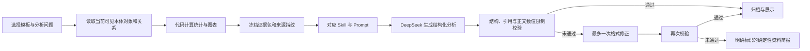

# Reports：从本体事实到经营决策报告

## 使用方式

本机访问 http://127.0.0.1:5112/reports ，本体工作台侧栏已有 Reports 入口。

1. 选择管理层／Boss、GTM／渠道策略、客服运营、数据与风险四个视角之一。
2. 填写想分析的问题，例如“当前哪些服务和数据问题值得优先投入，如何验证？”；选择语义版本。
3. 选择 DeepSeek 分析或仅确定性资料简报，点击生成。
4. 查看摘要、分角色分析、商品项履约资料流、场景／国家／型号知识分布与订单快照明细。
5. 点击依据按钮核对数值、定义和对象 ID；在生成记录中查看 Skill、Prompt、数据版本和校验过程。
6. 从历史报告重新打开；可导出 Markdown、完整 JSON，或通过浏览器打印保存为 PDF。Markdown 同时保留图表数据及订单表。

## 四个模板具体做什么

| 模板 | Skill | 关注的决策 | 不应推断 |
|---|---|---|---|
| 管理层／Boss | skills/reports/executive/SKILL.md | 履约风险、资源取舍、需要拍板的核查事项 | 收入损失、ROI、已经获得的业务收益 |
| GTM／渠道策略 | skills/reports/gtm/SKILL.md | 国家名录、服务准备度、进入市场的验证步骤 | 以卖家数量判断市场份额或市场潜力排名 |
| 客服运营 | skills/reports/service_ops/SKILL.md | 工单样例场景、独立商品状态、知识适用范围 | 真实解决率、SLA、满意度和提效幅度 |
| 数据与风险 | skills/reports/governance/SKILL.md | 来源质量、金额粒度、缺失条件和动作边界 | 只因图上有关联，就认为事实已核验或操作已执行 |

每个模板有单独的 Prompt，位于 prompts/reports/。报告保存本次实际使用的 Skill、Prompt 及其指纹，后续修改模板不会改写历史报告。

## 本体如何成为报告的数据记忆

“记忆”是生成时读取的本体资料快照，不是把所有原始邮件都填进提示词，也不是模型自行新增事实。

服务端只读取客户可见知识和允许对象，通过明确关系取得订单、商品项、包裹、销售方与咨询场景。Python 负责统计；LLM 负责解释、提出假设与建议。报告归档保存指标值、口径、对象 ID、来源文件、图数据指纹和语义版本。原始邮件正文、完整地址、客户身份和外链不会作为报告模型输入。

已有数据包括 63 条首封邮件、16 单／24 个商品项／20 个包裹、330 条去重销售方名录身份和 872 条客户可见知识。每个商品项只计一次，流图表示商品项数量，不能称为资金流；按型号适用的知识有重叠，不能相加当唯一文章总数。旧版本业务快照采集时间仍未知，报告生成时间不冒充数据截止时间。

报告只写入 local/reports.sqlite，不改订单、知识、本体关系或售后规则，也不把模型的策略建议自动写回事实层。这里是应用层冻结和指纹记录，不宣称是不可篡改的生产审计系统。

## 生成流程与校验

图表和数字由代码生成；模型正文不自行添加数值。每个分析章节包含观察、待验证解释、建议及证据编号。校验失败记录和调用次数保留，修正仍失败时不标为模型分析完成。格式和引用通过不等于策略建议已被业务人员确认；用中文数字表达的虚假断言等问题也不能仅靠这些检查完全排除，重要建议仍需逐项核对与业务复核。

## 图二这种 MCP → Agent 路线是否可行

可行，且有正式产品支持。Palantir 的 Ontology MCP 将应用对象、Action 和查询函数暴露给外部 Agent；其 Chatbot 工具支持对象过滤、聚合、沿关系查询和函数调用。它提供的是受限制的业务能力接口，而不是让模型任意执行数据库操作。[Ontology MCP](https://www.palantir.com/docs/foundry/ontology-mcp/overview)；[Chatbot 工具](https://www.palantir.com/docs/foundry/chatbot-studio/tools)。

本项目的两个入口共用业务逻辑：网页在服务端直接调用；外部客户端经官方 SDK 的 stdio MCP 调用。报告网页内部读取本体不能称为 MCP 通信；实际 MCP 传输由独立客户端验证。

原有 17 个工具增加 5 个报告工具，总计 22 个：

- list_report_templates：发现可选模板与角色契约。
- generate_report：取得本体证据、调用模型并保存报告；mode=snapshot 不调用模型。
- list_reports：查看本地报告归档。
- get_report：读取生成时保存的报告快照。
- get_report_evidence：追溯某项报告指标的定义和来源对象 ID。

外部 Agent 可继续用 get_instance_detail、get_instance_topology 查看相关对象与局部关系。查询当前对象时应与报告生成时的冻结统计区分，数据可能已经变化。

报告生成会创建本地归档且 live 会消耗模型调用，因此工具声明 readOnlyHint=false。它与正式业务变更分开：ONTOCARE_MCP_ALLOW_WRITES=0 仍允许用户请求生成报告，但不允许提交业务复核动作。生产环境仍需身份、租户和字段权限、调用预算、实时资料及人工审批。

## 复查

- 工程检查：`.venv/bin/python -m pytest -q`。
- 真实 MCP＋四模板＋模型生成：`.venv/bin/python scripts/verify_report_generation.py`。这会产生真实模型调用并保存本地报告。
- 结果：reports/report-generation-verification.json。

联调通过只能证明这些模板和接口在本次环境中跑通；它不是对所有经营判断正确性的背书，也不等于真实客服解决率。
