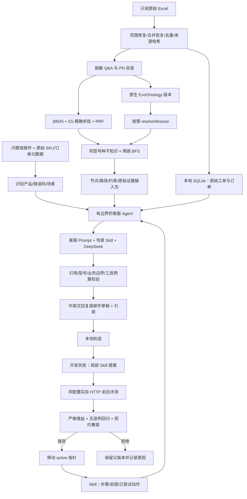

# 架构与数据流

## 边界

1. 本体提供“什么对象、何种条件、哪份来源”；Skill 提供顺序和会话行为。
2. `claims` 是用户报告；`verified` 只放本地查询工具输出，订单输出也只是资料快照。
3. 未知型号或冲突型号不跨产品兜底。匹配 PN 后，原生 resolve 返回的关系决定允许使用的知识 ID。
4. 本体原始文件、业务 Schema、Skill、工具描述分别进入版本 bundle 哈希；运行代码通过 Git 修订和文件哈希记录。工具描述变化不等于工具实现已改变。
5. 客服只生成建议／草稿；没有真实退款、换货、发信、实时物流工具。
6. 本地服务只绑定 127.0.0.1；trace 接口用于单用户演示，未实现多租户认证，不能直接作为生产服务开放公网。

## 本轮变化

初始 Skill 故意保留“未继承已完成检查”的最小能力，作为受控基线。提案器从失败输入识别该机制缺口，候选开启继承并补充明确清空／无阻塞报告的识别。实际客服接口读取候选 Skill；不是评测器读取一个新字段后自行给分。

本轮不改变模型参数，也未自主增加 Schema 字段或访问工具。Schema 与工具已随版本冻结并校验；不需要的改动不会为了展示进化而强行制造。

## 比赛界面与真实模型接入

后续运行时改版将安小克聊天和实际证据图放在同一页，保留全量资料、本体与旧评测入口。真实回复使用独立的系统 Prompt 和四类场景处理文件；系统指令与用户／资料数据分开传入。相似知识种子来自 BM25/E5/RRF，图搜索只沿真实关系在同型号范围内扩展两跳，不通过产品中心扩展到无关故障。它不是社区检测或新的自主进化实验。

主模型为拥有者显式配置的 `DeepSeek-V4.1-Flash`；实际返回的模型、用量、完整调用耗时和验证结果均记录。模型失败或回复被拦截时，页面明确显示保底状态。Judge 使用独立配置，尚未因接入主模型而自动启用。运行时 Prompt、图搜索契约与代码哈希见新的模型接入报告；历史离线曲线对应原冻结运行，不能挪作本次模型评测结果。
