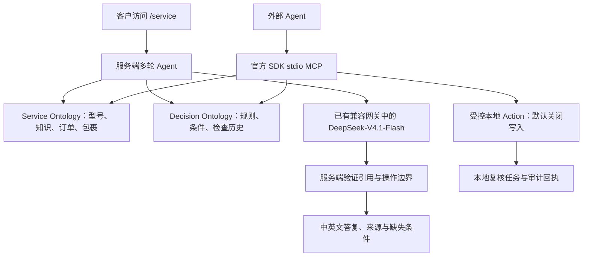

# 从本体地图到安克客服智能体

## 可直接用于项目介绍的文字

安克智能客服把赛题中的订单、商品、包裹、销售方、客诉和知识文章组织成有现实业务含义的对象，以来源可追溯的关系连接起来，形成 Service Ontology；再将业务 SOP 中的补发、换货、质保与材料要求转成有明确适用条件的规则、计算函数和受控动作，形成 Decision Ontology。智能体每轮先确认型号、订单和当前问题，查询适用对象与原文，再检查已知条件和缺失证据，由 DeepSeek 组织中英文答复。信息不足时追问，状态不明时保留未知，操作成功只认工具回执。网页客服通过服务端调用这套能力，外部 Agent 则可通过 MCP 接入相同的查询、判断与本地复核工具，使本体从可视化地图变成可调用、可检查的服务底座。

这是项目的设计与已实现能力说明；当前正式退款、换货、补发和真人接单仍未对接。

## 1. 最后一次资料复核结论

`reports/final-source-audit.json` 将原始 Excel 每个来源行、每个字段与本地来源库直接比较，全部一致：63 条工单、24 条订单商品、593 条扫地机 Q&A、282 条吸奶器文件 Q&A、336 条销售方原始记录。三个拆分工作簿也与总表逐行一致。原始文件不做修改；中文对照文件、备份、Excel 临时文件不重复计为新事实。

业务模型包含 16 个订单、24 项购买记录、16 个可售 SKU 规格、20 个包裹、330 条去重销售方名录身份、10 个国家／市场及 13 个知识目录。Q&A 共 875 篇，872 篇可向客户检索，3 篇隐藏内容保留在管理端。工单 11 张嵌入图和总表 8 个外部超链接已保留或定位，但不等于图片内容已理解。

本轮重新阅读赛题 Word 正文和业务 SOP 原图，将原图的 4 条建议／材料要求以及正文的 1 条销售方匹配规则整理进 `data/competition-rules.json`。每条保留来源文件与校验指纹；规则可在本体 ServiceRule 类型中查看，Function `evaluate_service_decision` 已执行条件检查。

仍不能说「所有赛题流程已闭环」：远程飞书资料和百炼教程未完成访问核验；客户图片与链接内容尚未核实；满意度调查、寄修、正式售后单据及外部系统操作未接通。Word 中的流程图已阅读，但未把其中每个流程节点都宣称为已实现功能。现有本地 Action 创建的是通用复核任务，并非已接入的退款单或换货单。

## 2. 数据建模如何做好

从客户问题和客服需要作出的决策倒推模型，再回到来源建立映射。例如「只收到配件，主机去哪了」要求区分订单、订单项和包裹；仅把订单 sheet 改名成 OrderData 会丢失这个业务粒度。

| 概念 | 现实含义与身份 | 关键建模约束 |
|---|---|---|
| ProductModel | 工程型号 PN | 同名产品可能存在多个 PN，先消歧 |
| ProductOffering | 可购买的商业 SKU 规格 | SKU 不等于工程型号，套装／配件分类可能待确认 |
| Order | 一次购买交易 | 订单号不是客户归属认证 |
| OrderItem | 交易中的一个购买项 | 独立数量、发货状态、原始金额与质保日期 |
| Shipment | 有明确运单的包裹 | 内装物、分配数量和实时状态未知则保留未知 |
| Dealer | 来源国家内的销售方名录身份 | 未统一为全球法人，跨国同名不直接合并 |
| KnowledgeArticle | 有发布状态和适用范围的知识文章 | 文件名不决定产品范围；发布且可见并匹配 PN 才能检索 |
| SupportTicket | 一次客诉与客户陈述 | 客户自述与已核验事实分开保存 |
| ServiceRule | 来源明确的服务规则 | 适用规则不等于条件已满足 |
| ReviewTask | 本地提交成功的复核任务 | OPEN 不代表外部真人已经接单 |

关系表达真实联系：订单包含购买项、购买项购买某规格、订单关联包裹、文章适用型号。`reported_on_item` 特意只表示包裹信息来自哪个商品行，避免凭来源排版推断包裹装载。技术证据／映射可以保留，浏览时要与业务对象区分。

属性要明确粒度、来源与时间。例如 amount_raw 是源行金额，币种代码和金额粒度尚未确认，所以不可跨行相加或乘数量。预计发货日期不等于实际日期。Anker014 的发货早于购买属于来源冲突，保留待核查，不能静默修正。

类分组是导航结构，不等同于 OWL 的继承推理。业务边的基数目前是声明，不能据此声称数据库已经自动执行完整约束。

## 3. Service Ontology 与 Decision Ontology 怎么配合

这两个名称在本项目中代表两种逻辑视图，不要求建两套互不相通的数据库，也不能当作 Palantir 强制采用的两个官方产品名称。

| 层 | 回答的问题 | 本项目做法 |
|---|---|---|
| Service Ontology | 服务涉及什么对象、彼此是什么联系、依据在哪 | 型号、商品项、包裹、销售方、工单、文章及来源关系 |
| Decision Ontology | 当前满足哪些条件、哪些未知、下一步可建议什么 | ServiceRule、Condition、Constraint、检查历史与决策函数 |
| 操作与审计 | 谁可提交什么变更、结果是否真的成功 | ActionType、本地事务、幂等、状态变化、事件表、审计及 ReviewTask |

决策与操作要区分：Function 负责计算，Action 负责受控变更。Decision Ontology 不只是一张流程图，也不意味着计算出建议就自动办理。操作层还要身份、权限、确认与实际接口。

已实现例子：`evaluate_service_decision` 接收结构化事实，返回 `outcome / checks / missing_facts / source_rules / can_execute=false`。未知字段返回 UNKNOWN；传入「verified=true」也只是调用方提供的事实，并没有独立完成认证，函数始终不执行售后。

- 物流显示送达而客户说未收到：进入争议核查；原文「一般不补发」不能被解释成无例外拒绝。
- 物流未送达且客户未收到：可考虑补发，但还需核对资料、身份与快照时效。
- 适用排查已完成、故障仍存在、在核查日质保有效：可考虑换货；购买凭证、寄送信息、图片／视频、故障产品 SN 仍需核验。
- 缺日期、缺检查结果或材料：追问／复核；缺失不是 false，也不是自动拒绝。

完整退款资格必须结合对应产品的适用政策，赛题 SOP 本身不能补足全球退款规则。函数是有来源的本地 Python 实现，不是假装能够执行任意 JSON 表达式的通用规则引擎。

## 4. Palantir 是怎样从本体做出客服 Agent 的

官方 Agent Builder 明确给出客服例子：将 order ID 作为输入，预先查到该订单及包裹，放进上下文；Agent 通过对象查询、Function 和 Action 完成任务。这说明本体并不会在画完之后自动变成 Agent，还需要输入、状态、上下文、模型、工具和执行边界。[Agent Builder core concepts](https://www.palantir.com/docs/foundry/agent-builder/core-concepts)

Chatbot Studio 的工具包括 Object Query、Function、Action 和澄清工具；Object Query 可以限定对象及属性，执行筛选和关系遍历；Action 可以配置自动或经确认后运行。对安克的做法是按问题提供订单／商品／包裹或知识原文，再让模型在受控范围内查询和表述。[Chatbot Studio tools](https://www.palantir.com/docs/foundry/chatbot-studio/tools)

官方检索上下文支持 Ontology、Document 与 Function-backed context，并可每轮先确定性运行检索。我们据此采用先提供型号限定的证据包、再允许模型针对缺口补查的方式，减少无目标的重复工具调用。[Retrieval context](https://www.palantir.com/docs/foundry/chatbot-studio/retrieval-context)

技巧是把大模型适合做的对话、归纳和追问，与需要确定性的身份、日期、渠道规则、状态和事务分开。保留真实对象 ID、来源行、缺失条件、工具日志和回执，才能检查它为什么给出这个建议。这里的「为什么」是可核对的事实与规则，不是要求模型输出隐藏思维过程。

## 5. MCP 是不是必须

不是。应用内可通过同进程函数或服务端 API 调用本体能力。MCP 的价值是让外部 Agent 用标准工具发现和调用相同能力；MCP 本身不负责模型推理、会话记忆、业务身份或权限治理。

本项目已有两条路径：

17 个 MCP 工具已注册，新增 `evaluate_service_decision`。完整输入 schema 由实际 `tools/list` 生成，见 `web/service-tools.json`。配置在项目根 `.mcp.json`。网页调用服务端 Python 工具，外部示例通过真实 stdio MCP；二者共用业务查询函数，并未把网页 HTTP 请求误称为 MCP 通信。

Palantir 官方也区分消费者使用的 Ontology MCP 与开发者使用的 Palantir MCP。当前接口参考前者，对外提供查询、计算和预定义本地复核，不开放任意修改本体结构或数据库的入口。[Ontology MCP](https://www.palantir.com/docs/foundry/ontology-mcp/overview)

## 6. 落地页、模型与演示方法

访问 `http://127.0.0.1:5112/service`。页面包含咨询入口、订单／购买渠道选填项、中英文答复、知识出处、商品包裹、渠道核对、规则缺口和处理记录。示例按钮开启独立案例，避免把上一个订单或销售方带入不相关问题。

模型使用现有服务端密钥，读取 `local/deepseek-config.json` 或 ONTOCARE_LLM_CONFIG。当前配置通过已有兼容网关使用模型标识 `DeepSeek-V4.1-Flash`，不是将其声称为已验证的 DeepSeek 官方直连型号。密钥仅在服务端读取，不放进页面或 MCP 配置。页面初始「已配置」只代表配置存在；每条答复会区分调用成功与本地保底，不能靠状态标签冒充真实调用。

演示顺序：E25 错误 3212 的适用排障 → 表示已做检查，检查多轮是否重复 → Anker008 主机／配件分批发货 → Anker001 多包裹 → US/best buy 渠道核对 → 查看规则 UNKNOWN 与待收材料 → 在 Action 页面演示本地复核提交及审计。

运行 `scripts/verify_service_delivery.py --live` 可验证真实 MCP 和网页同一客服接口的模型请求，结果写入 `reports/final-service-verification.json`。测试和样例的成功只能证明这些场景，不表示所有未知客户问题都经过质量验收。

正式生产仍需：客户身份与订单归属、实时同步和快照采集时间、完整地区／品类政策、材料核验、受控操作接口与审批、外部回执、人工接管、满意度、监控及真实客户回归集。赛题允许模拟售后工具，因此可继续把 RefundRequest / ReplacementRequest 做成本地申请工具；当前不把通用 ReviewTask 冒充这两种已经落地的申请单。
