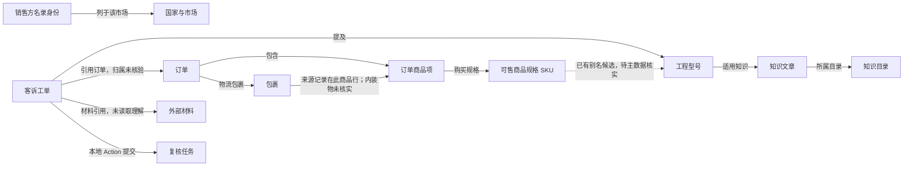

# 安克客服：全 sheet 本体工作台与 MCP 交付说明

本次交付是可运行、可检查的本地演示版本。原始工作簿只读保留；五个 sheet 的完整字段通过来源浏览查看，业务对象、关系通过本体浏览查看。冻结的 v0 / candidate-1 语义文件未重写；新增独立 business-v1 业务投影。切换语义版本不会回退订单快照或本地动作状态。

## 1. 数据是否都考虑了

| Sheet | 来源行数 | 放在哪里 | 不应推断什么 |
|---|---:|---|---|
| 客诉工单信息 | 63 | SupportTicket、问题原文、8 个 ExternalMaterial 超链接引用；来源库保留 11 张嵌入图，涉及 10 个工单 | 首封邮件是客户陈述；不代表故障确诊、身份认证或附件理解 |
| 订单信息 | 24 | 16 Order、24 OrderItem、16 ProductOffering、20 Shipment；完整原始 14 字段可查 | 商品金额不可直接当订单总额汇总；币种未核实；包裹引用商品行不等于核实内装物 |
| eufy Robovacs Q&A | 593 | KnowledgeArticle、目录、适用 PN、证据与来源映射 | 文章适用范围不等于当前设备已经确诊 |
| eufy Breast Pump Q&A | 282 | 同上，含政策部件与条件；279 客户可见、3 隐藏 | 隐藏文章只在管理视图保留，客服知识检索和通用实例工具不能访问 |
| 经销商信息 | 336 | 330 条按国家和原名去重的 Dealer 名录身份、10 个 Country/市场节点 | 名录出现不能证明当前授权有效、适用品类或客户售后资格 |

共 875 篇 Q&A，客服可检索 872 篇。13 个知识目录节点保留路径与父子关系。6 条经销商重复行保留在来源视图，但不重复生成业务节点。

不单独建模为对象的内容：排版序号、空白填充列、每个单元格和内容相同的镜像文件。其来源数据仍可核对。来源工作簿中的文字或附件均作为资料，不作为 Agent 指令。

尚无真实 Customer / Device / SellerAuthorization 的充分主数据：不能凭邮件地址创建经过认证的客户、凭 PN 创建一台真实设备，或凭名单伪造授权记录。已有 CheckObservation 等目标对象继续标为设计示例。

## 2. 按业务理解地图



ProductModel 是工程型号；ProductOffering 是可购买的 SKU 规格；OrderItem 是一次交易中的购买项。三者身份与粒度不同。Dealer 当前身份按「国家＋来源名称」保留；跨国同名是否同一法人、名称碎片是否同一店铺需要主数据确认，不能自动合并。

Anker008：主机商品未发货，配件商品已发货，订单聚合为 PARTIALLY_SHIPPED。预计日期保留原文；不能当实际日期。Anker001 的两条运单拆为包裹；不虚构包裹包含哪些件。Anker014 存在发货早于购买的源值，列为核查项。

## 3. 四类契约与真实运行的关系

| 类别 | 本次例子 | 定义与执行 |
|---|---|---|
| ObjectType | Order、OrderItem、ProductOffering、Shipment、Dealer | `data/business-schema.json` 声明新增类型；既有类型由管理投影说明属性和语义。部分既有属性仍是实际值汇总，尚未变成统一强制校验器 |
| LinkType | contains_item、purchases_offering、has_shipment、listed_in_country | 声明方向、端点、基数与来源；当前基数是结构声明，不等于底层数据库已自动强制约束 |
| ActionType | submitForReview | 注册的本地事务处理器校验工单、状态、权限用途及幂等键，写入状态/任务/关系/事件/审计；事件留在本地 outbox，未投递外部坐席 |
| FunctionType | lookup_order、check_dealer、plan_customer_service | Python 业务逻辑执行查询与计算，MCP 和网页复用相同服务；没有伪装成已经发布的 Foundry Function |

所有 JSON 是本项目契约，不是 Palantir 官方导入导出格式。不能将含 `${...}` 的示意 JSON 当作已实现的通用规则解释器。四类入口可查看 JSON、真实实例或记录、类型引用图以及四篇深度剖析；设计对象没有伪造实例。

## 4. 工作台与 MCP 如何演示

打开 `http://127.0.0.1:5112/ontology/manager`：

1. 「全 sheet 来源覆盖」点每个 sheet，再点来源行，在右侧核对全部字段。
2. 「拓扑」选「订单与物流」，查看 Order → OrderItem → ProductOffering，以及 Order → Shipment。点类查看实例，再进入实例局部图。
3. 「客服与 MCP 接入」运行 Anker008 发货问题；填 US / best buy 核对销售方；输入确认 PN 与症状检索知识。
4. 四类 Type 入口检查状态；FunctionType 中的业务查询已实现，目标动作与目标观察对象保留设计状态。
5. 完整多轮排障继续使用原有客服工作台；订单查询已复用新增的逐商品与包裹投影。新增面板是证据规划，不将它标为已完成多轮对话。

MCP 使用官方 Python SDK v1 维护分支，依赖界定为 `mcp>=1.30,<2`；当前环境为 1.30.0。这是兼容性选择，并非声称采用 SDK 最新主版本。参考 [SDK v1 README](https://github.com/modelcontextprotocol/python-sdk/blob/v1.x/README.md)。

项目根目录 `.mcp.json` 已包含本机绝对路径配置，使用 stdio 启动。外部客户端在项目根加载配置即可；换机器时需要调整解释器与工作区路径。未修改用户的全局客户端配置，也不把这个 stdio 服务冒充远程 HTTP 端点。

```sh
.venv/bin/python -m pip install -e .
.venv/bin/python -m ontocare.cli business-build --source '../黑客松智能服务赛题资料.xlsx'
.venv/bin/python -m ontocare.cli serve --port 5112
# 由外部客户端按 .mcp.json 启动，或手动启动 stdio：
.venv/bin/python -m ontocare.service_mcp
# 独立进程通过 MCP 联通，不调用大模型：
.venv/bin/python scripts/external_agent.py --message 'Anker008 物流怎么样？'
# 复用已有兼容模型配置，完成模型回答：
.venv/bin/python scripts/external_agent.py --message 'Anker008 物流怎么样？' --live
```

`--live` 使用已有本地模型配置或 ONTOCARE_LLM_CONFIG，不在交付文档中保存密钥。Agent 先通过真实 MCP 获取规划证据，再允许模型在有限轮次内查询订单、销售方与知识，最后组织回答。非 live 模式只是确定性的工具联通检查，应当明确区分。

17 个工具：evaluate_service_decision、list_ontologies、list_topologies、list_classes、get_class_detail、list_relations、search_instances、get_instance_detail、get_instance_topology、search_knowledge、lookup_order、check_dealer、list_types、submit_for_review、get_source_coverage、plan_customer_service、get_delivery_report。完整输入 schema 来自实际 SDK `tools/list`，保存在 `web/service-tools.json`，网页点工具可查看。

实例分页每页最多 50；批量详情最多 20，每项关系最多 100；局部拓扑最多 3 跳/100 节点，并标截断。知识按发布状态、客户可见性和 PN 限定；默认不返回地址，邮件和电话号码作脱敏处理，运单号用于物流查询保留。不能因有这些限制就宣称已具备生产权限系统。

默认只读；`submit_for_review` 会返回 WRITE_DISABLED，不能由客户端参数伪造角色启用。仅在可信本地演示中由服务端设置 ONTOCARE_MCP_ALLOW_WRITES=1，才可使用已有本地演示身份提交复核；正式生产必须换真实身份与授权实现。已有本地 Action 页面不受 MCP 只读配置影响。

## 5. 参考 Palantir 的交付方法

官方不是只有画图：它强调先明确业务决策与结果，围绕结果选择数据、搭建应用并记录决策及后续影响。这次借此形成「业务问题 → 来源盘点 → 现实对象和身份 → 关系 → 计算函数 → 受控动作 → 应用/MCP → 真实任务验收」的项目 SOP；这是针对安克项目整理的方法，不能说是 Palantir 唯一认证标准。[官方 Delivering a use case](https://www.palantir.com/docs/foundry/getting-started/delivering-a-use-case)

官方本体设计要求从现实业务语义建模。本项目据此拆开订单、商品项、SKU 规格与包裹，并保留来源映射。后续应补强统一声明校验、身份治理和数据质量流程。[Ontology best practices](https://www.palantir.com/docs/foundry/ontology/ontology-best-practices/)

对外部客服 Agent 应参考 Ontology MCP：它暴露对象读取、预定义动作及查询函数；Palantir MCP 则面向开发平台结构的构建者。本项目的 bounded 查询工具是本地实现，不假定与 Foundry 的 SQL/权限模型兼容。[Ontology MCP](https://www.palantir.com/docs/foundry/ontology-mcp/overview)

官方架构给出外部 Agent 通过 OMCP 消费对象、动作和函数的路径。此处沿用这一职责划分：业务定义和可执行边界留在服务端，外部模型负责对话与工具选择。[Sample architecture](https://www.palantir.com/docs/foundry/ontology-mcp/sample-architecture)

## 6. 正式对接客户还缺什么

| 能力 | 已有 | 需补齐和验收 |
|---|---|---|
| 客户身份 | 本地演示 | 登录身份、订单归属、租户/角色/字段权限；跨客户访问测试 |
| 实时数据 | Excel 快照、来源指纹 | OMS/CRM/物流增量同步、采集时间、失败重试、数据质量监控 |
| 授权与政策 | 国家卖家名录、部分政策原文 | 有效期、品类/区域范围、渠道政策和完整资格规则；unknown 分支与人工复核 |
| 业务操作 | 本地复核事务和 outbox | 正式工单/坐席/退款接口、审批、外部幂等与补偿；外部系统实际回执 |
| 对话 | 原有多轮排障；外部 Agent 单次问题工具循环示例 | 外接 Agent 的长期会话、已做检查/结果事实、转接摘要、人工接管与满意度 |
| 图片与附件 | 嵌入图和超链接定位 | 受控下载、图像理解、证据核验与可追溯结论 |
| 部署与运营 | 本机 HTTP 工作台和 stdio MCP | 远程 MCP 传输与认证、部署、监控、告警、日志留存、质量与成本/时延指标 |

不能把本地复核任务创建成功说成真人已接单，更不能说退款或换货已完成。仍需真实生产对接资料才能完成这些接入。

本轮追加赛题 Word 原图 SOP 的 ServiceRule 与 evaluate_service_decision；完整资料覆盖以 reports/final-source-audit.json 为准。原先的全 sheet 覆盖不能等同于全赛题流程已执行。
