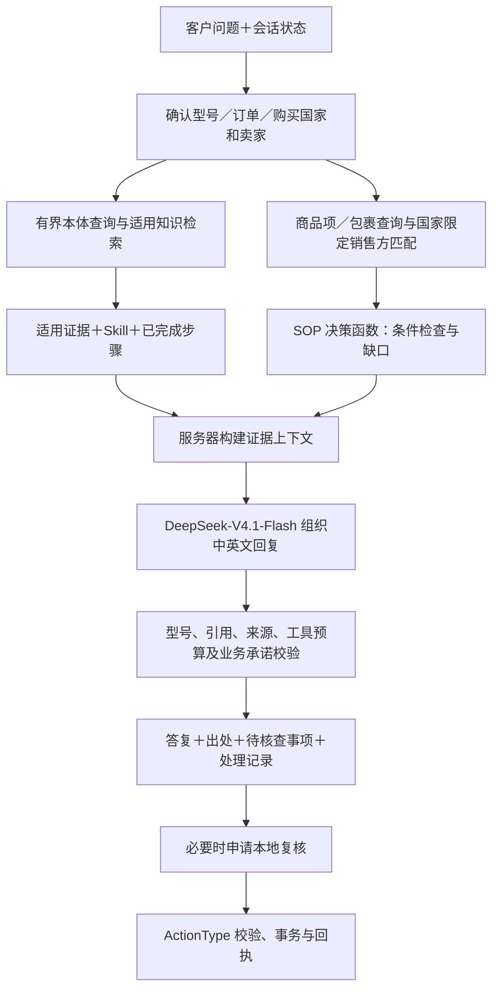

# OntoCare：从资料、本体地图到客服 Agent

## 已经做到了什么

这次在 OntoCare-RSI-Rebuild 中完善数据模型和客服链路，未修改原公开项目。地图是对象与关系的可视化，Agent 通过服务器上的查询、检索、规则函数和受控动作使用同一批业务数据。项目采用 Palantir 的对象／属性／关联／动作思路，尚未接入或部署到 Palantir Foundry，不是它的导入格式复刻。

本地正式总表五个 sheet 的全部行、全部字段已与入库来源逐行比对，三个拆分文件与总表对应资料一致，没有重复算样本。63 封首封邮件、875 条 Q&A（872 条客户可见）、24 个订单商品行对应 16 个订单、336 条销售方来源行去重为 330 个国家限定身份；另外建立 20 个物流包裹、16 个可售 SKU 规格、10 个国家／市场和 13 个知识目录。清单及每个字段的检查结果见 `reports/final-source-audit.json`。

“全部工作表保留”不表示已经核验全部业务事实：11 张嵌入工单图片有来源定位，8 个外部材料引用有关系，但其内容没有全部理解；飞书远程补充资料和百炼教程未完整验证。赛题 Word 的 SOP 图片已核对转录，4 条售后建议规则加正文的 1 条销售方规则进入数据和决策工具，仍待业务人员确认。正式 OMS、物流、坐席、满意度及退款系统均未接通。

## 如何做好数据建模

先确定回答什么业务问题，再选择对象粒度和主键，不把 Excel 一行简单等同于一个现实实体。

| 对象 | 身份与属性 | 主要关系与边界 |
|---|---|---|
| ProductModel 工程型号 | PN；产品适用范围 | 关联适用 Q&A、错误码和检查概念；型号不等于一台已认证设备 |
| ProductOffering 可售规格 | SKU；商品描述、主机／套装／配件候选 | 被商品项购买；已有型号别名仅构成可追溯候选，不按前缀硬猜 |
| Order 订单 | 订单号；来源行、派生整单状态 | 包含多个商品项、多个包裹；订单号不证明客户归属 |
| OrderItem 商品项 | 原始行标识；SKU、数量、购买／质保日期、金额原值、发货状态 | 一个订单中的购买项；金额粒度未知时不加总、不乘数量 |
| Shipment 包裹 | 订单＋运单号；承运商、源物流状态、日期与来源 | 关联订单和报告它的商品行；不等于包裹内容已核实 |
| Dealer 经销商名录身份 | 来源国家＋卖家名；授权范围和有效期未知 | 列于某国家名录；不跨国强行合并同名主体 |
| DealerCheck 销售方核验 | 会话匿名索引、客户提供的国家与卖家、匹配规则和理由 | 关联国家、候选卖家、同会话提及订单；全部明确标注陈述而非核实购买关系 |
| KnowledgeArticle / Evidence | Q&A ID、正文、可见性、PN、源行和内容指纹 | 图用于导航，原文用于支持事实；隐藏的三条不进入客服召回 |
| ServiceRule / ReviewTask | 来源规则／本地复核任务与审计 ID | 规则建议不执行退款；复核任务不代表真人接单 |

每个重要关联都保留依据。Anker008 的主机未发货、配件已发货，所以派生整单状态是部分发货，不能沿用第一行状态覆盖整单。Anker001 的两条运单生成两个包裹，但来源没有说明内装物，保留未知。Anker014 发货早于购买的日期异常保留原值并进入待核查。金额字段保留原文和可解析数值，币种代码、金额粒度未知，不把“$”默认解释为 USD。

## Service Ontology 与 Decision Ontology

这是本项目对同一本体底座的两个业务视图，不是 Palantir 强制规定的两个产品模块。

- **Service Ontology（服务事实视图）**：是什么产品、买了什么、哪个包裹、哪条知识适用、证据来自哪里。回答“知道什么”，同时记录不知道什么。
- **Decision Ontology（决策与操作视图）**：核验物流、是否收到、适用排障是否完成、质保和购买材料是否齐全；输出需要补充的事实与允许的下一步。回答“基于当前资料可以做什么”。

决策函数把每项条件记录为 PASS / FAIL / UNKNOWN。未知不会被当作已通过或已拒绝。赛题授权规则使用购买国家精准匹配、销售方规范化精确或模糊匹配；自动模糊命中暂用相似度 ≥0.90 且领先次候选 ≥0.10，≥0.72 的弱候选留待复核。数字阈值是工程选择，赛题未规定，尚未通过带人工标签的卖家数据校准。名单匹配与真实售后资格分开。

ActionType 是受控业务写入入口。当前 submitForReview 校验参数、服务端身份、状态和幂等键，原子写入本地任务、状态、关联、事件和审计。它不是退款、补发或换货接口。正式上线需补登录、订单归属、审批、外部回执和失败补偿。

## 有 Ontology 后，怎么成为 Agent

网页不是把整张图一口气塞给模型：先按业务场景调用订单／经销商工具或型号限定的 BM25＋向量召回，做有界图查询，再把相关原文、关系、状态与规则组织成小上下文。服务器先确定边界，Skill 约束处理方法，模型负责语言组织和有限补充查询；每次最多六个工具调用。业务场景通常直接使用已取得的完整证据包，不重复查图。

订单和渠道工具结果已经进入真实模型输入及返回轨迹，而不只在后台页面展示。网页可看逐商品、独立包裹、销售方和决策卡片。API Key 使用已有本地后端配置，不返回浏览器。模型网络失败仍明确报告；这次联调成功不保证第三方服务永远可用。

## MCP 是否必需，已经封装什么

MCP 是让外部 Agent 调用业务能力的协议适配层，本身不是 Agent，也不负责替模型推理。当前网页内部直接调用 Python 业务函数即可；外部客户端可通过同样业务函数的 MCP 服务访问，避免做两套规则。

本地 `.mcp.json` 和 `ontocare.service_mcp` 已封装 17 个工具，包含对象／关系／实例查询、最多三跳的局部拓扑、适用知识检索、订单查询、经销商匹配、SOP 决策和本地复核入口。默认只读；实际 SDK 客户端已完成初始化、列工具及工具调用验证。`scripts/external_agent.py --live` 演示外部进程经真实 stdio MCP 取得资料，再由 DeepSeek 生成答复。它是演示用单次问题工具循环，长期会话由网页 Agent 保存。

Palantir 官方也将对象查询、函数与 Action 接给聊天机器人；其中对象查询可以限制可见对象及属性并沿关系查询，Action 可以配置为确认后执行。迁移技巧是先做好小而明确的业务工具，把身份、适用范围和变更校验放在服务端，避免靠一句系统提示词承载全部业务规则。[官方 Chatbot 工具说明](https://www.palantir.com/docs/foundry/chatbot-studio/tools)

对于外部 Agent，更贴近本项目的是 **Ontology MCP**：它暴露应用中的对象、预定义动作与查询函数。Palantir MCP 主要面向构建和修改平台结构，二者用途不同。此项目只实现本地等价职责，不宣称具备 Foundry 的生产权限体系。[官方 Ontology MCP](https://www.palantir.com/docs/foundry/ontology-mcp/overview)

## 怎样验收，不能如何宣传

分别验收来源逐行一致、对象关系合法、异常保留未知、客服工具确实进入模型输入、真实 MCP 传输和真实模型回复。工程检查数量是测试数量，不是 63 封工单数量。构造联调用例通过也不等于真实问题解决率，更不能拿这次功能补齐冒充多轮 RSI 收敛实验。历史进化曲线不因此自动产生新结果。

接下来真正有价值的是加入订单归属和实时接口、收集真实处理结果、冻结未见测试集，再做配对评测、消融和业务人员盲审；有了完成结果和回访数据，才报告真实解决率。
